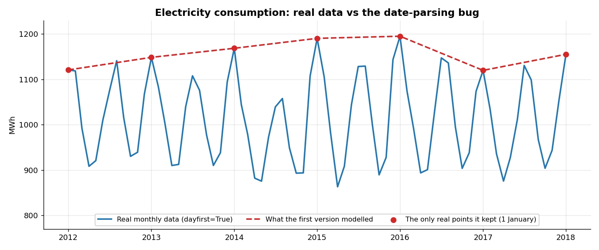
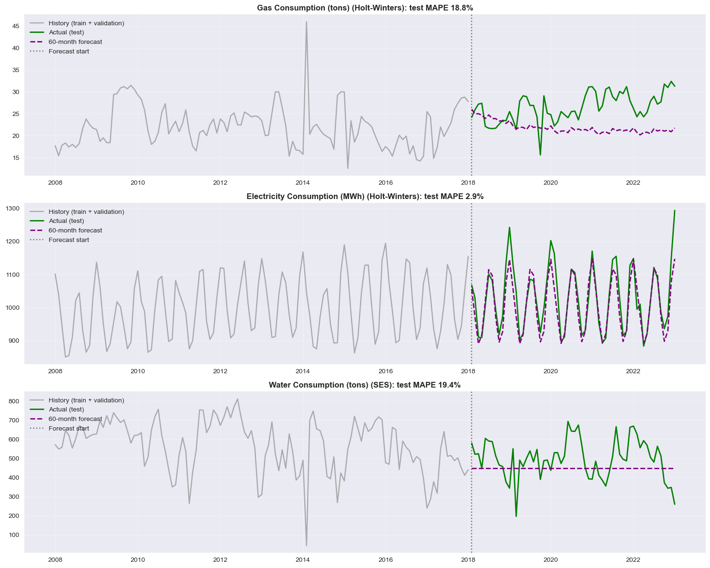

# Energy Demand Forecasting

Forecasting 60 months of monthly gas, electricity and water consumption with `statsmodels` (Simple Exponential Smoothing and Holt-Winters), and what I learned from finding and fixing a **date-parsing bug** that had quietly made up 91% of the data.

## The problem

The dataset has 33 years of monthly readings (January 1990 to January 2023) for three utilities: gas (tons), electricity (MWh) and water (tons). The goal is to forecast the last 60 months of each without seeing them, as a five-year planning forecast would.

## Approach

1. **Exploratory data analysis:** plotted each series, its yearly averages and its average by calendar month. Electricity has a strong upward trend and **two peaks a year** (winter and summer). Gas and water have almost no seasonality, just multi-year swings and outliers.
2. **Decomposition and stationarity:** seasonal decomposition shows seasonality explains 89% of electricity's detrended variation, but only 2% for gas and 6% for water. ADF tests on each series.
3. **Chronological split:** the last 60 months as the test set. The rest is split 80/20 into train and validation, never shuffled.
4. **Baselines:** Simple Exponential Smoothing (a flat forecast), plus a **seasonal naive** benchmark that just repeats last year.
5. **Holt-Winters:** added trend and seasonal components, and tuned trend type, seasonal type and damping (8 combinations per target) on the validation set.
6. **Final evaluation:** for each target, the model with the lowest validation MAPE is refitted on train + validation and forecasts all 60 test months at once.
7. **Residual diagnostics:** Ljung-Box and Shapiro-Wilk tests, ACF and Q-Q plots.

## The date bug I found and fixed

The dates are stored as day/month/year: `1/2/1990` means 1 February 1990. My first version used `pd.to_datetime(df['DATE'])`, which reads it as **2 January**. So every row landed in January, and setting a monthly frequency kept only the 34 rows dated 1 January. `interpolate()` then filled the other **363 of 397 months** with straight lines, and no error appeared.



The models were forecasting smooth lines between Januaries, and the test "actuals" were made-up values too. The fix is one argument, `dayfirst=True`, plus an assertion that every month has a real reading:

| 60-month test MAPE | With the bug | After the fix |
|---|---|---|
| Electricity | 2.6% | **2.9%** |
| Gas | 7.6% | **18.8%** |
| Water | 33.2% | **19.4%** |

The bug made gas look 2.5× better than it really is. What I check now: *after any reshaping, how many of my rows are still real data?*

## Results

| Target | Selected model | Test MAPE (60 months) | Test MAE | "Same as last year" benchmark |
|---|---|---|---|---|
| **Electricity** | Holt-Winters (additive, damped) | **2.9%** | 31 MWh | 3.5% |
| Gas | Holt-Winters (multiplicative trend) | 18.8% | 5.2 tons | 18.4% |
| Water | Simple Exponential Smoothing | 19.4% | 93 tons | 22.7% |



- **Electricity** is the success: the forecast tracks both yearly peaks for five years and beats the seasonal benchmark. On validation, Holt-Winters cut the error from 9.8% (flat baseline) to 2.5%.
- **Gas** is no better than repeating last year. Actual consumption climbed to around 30 tons a month by 2022 while the forecast stayed near 21, and nothing in the gas history signals that rise.
- **Water:** Holt-Winters didn't beat the flat baseline on validation, so the baseline was selected. One month (February 2014, 44.4 tons against a usual ~500) adds about 24 points to water's validation MAPE on its own.

## What I learned

- Check that the data is still real after every transformation. Interpolation can hide a broken pipeline completely.
- Compare against a naive benchmark, not just your own baseline. "Same as last year" is hard to beat for series with little structure.
- Choose models on the validation set and accept the result, even when it picks the simpler model.
- MAPE gets distorted by very small actual values. MAE and the median error give a fuller picture.

## What I'd improve

- Add temperature data (heating and cooling degree days), which likely drives electricity's two peaks.
- Compare SARIMA against Holt-Winters for electricity.
- Use rolling-origin evaluation (several forecast start points) instead of a single split.
- Report prediction intervals, not just point forecasts.

## Run it

```bash
pip install -r requirements.txt
jupyter notebook energy_demand_forecasting.ipynb
```

The notebook keeps its outputs, so you can read the charts and results without running it.

## Data

`data/energy_consumption.csv` holds 397 monthly readings of gas, electricity and water consumption from January 1990 to January 2023. One quirk: from May 2017 onwards, the water series repeats the values from January 1990 onwards exactly (98% of the water test months match October 1990 – September 1995). So the water data looks partly synthetic, and its results are best read as an exercise rather than a real-world forecast.
